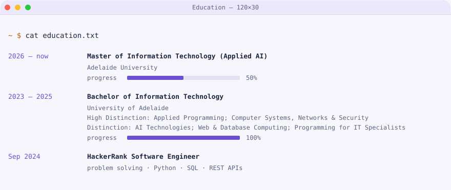
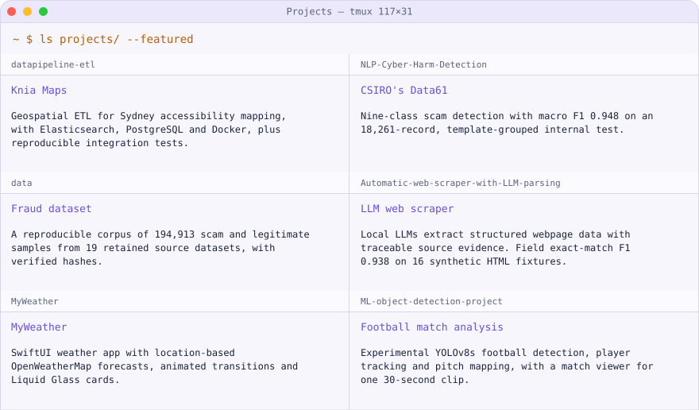
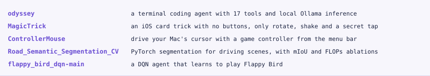
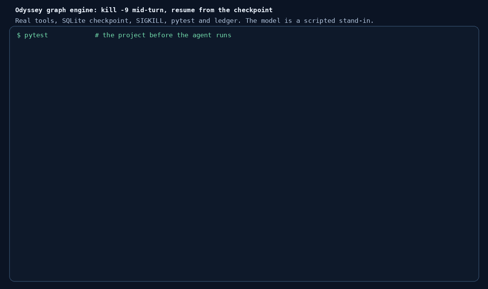
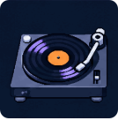
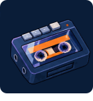

  

  
  

---

<picture>
  <source media="(prefers-reduced-motion: reduce) and (prefers-color-scheme: dark) and (max-width: 600px)" srcset="assets/profile-terminal-dark-mobile-static.svg" />
  <source media="(prefers-reduced-motion: reduce) and (prefers-color-scheme: light) and (max-width: 600px)" srcset="assets/profile-terminal-light-mobile-static.svg" />
  <source media="(prefers-reduced-motion: reduce) and (prefers-color-scheme: dark)" srcset="assets/profile-terminal-dark-static.svg" />
  <source media="(prefers-reduced-motion: reduce)" srcset="assets/profile-terminal-light-static.svg" />
  <source media="(prefers-color-scheme: dark) and (max-width: 600px)" srcset="assets/profile-terminal-dark-mobile.svg" />
  <source media="(prefers-color-scheme: light) and (max-width: 600px)" srcset="assets/profile-terminal-light-mobile.svg" />
  <source media="(prefers-color-scheme: dark)" srcset="assets/profile-terminal-dark.svg" />
  
</picture>

<h3 id="-education--certification">
  <picture>
    <source media="(prefers-color-scheme: dark)" srcset="assets/section-education-dark.svg" />
    
  </picture>
</h3>
<picture>
  <source media="(prefers-reduced-motion: reduce) and (prefers-color-scheme: dark) and (max-width: 600px)" srcset="assets/education-terminal-dark-mobile-static.svg" />
  <source media="(prefers-reduced-motion: reduce) and (prefers-color-scheme: light) and (max-width: 600px)" srcset="assets/education-terminal-light-mobile-static.svg" />
  <source media="(prefers-reduced-motion: reduce) and (prefers-color-scheme: dark)" srcset="assets/education-terminal-dark-static.svg" />
  <source media="(prefers-reduced-motion: reduce)" srcset="assets/education-terminal-light-static.svg" />
  <source media="(prefers-color-scheme: dark) and (max-width: 600px)" srcset="assets/education-terminal-dark-mobile.svg" />
  <source media="(prefers-color-scheme: light) and (max-width: 600px)" srcset="assets/education-terminal-light-mobile.svg" />
  <source media="(prefers-color-scheme: dark)" srcset="assets/education-terminal-dark.svg" />
  
</picture>

<h3 id="-featured-projects">
  <picture>
    <source media="(prefers-color-scheme: dark)" srcset="assets/section-projects-dark.svg" />
    
  </picture>
</h3>

<picture>
  <source media="(prefers-color-scheme: dark) and (max-width: 600px)" srcset="assets/projects-featured-dark-mobile.svg" />
  <source media="(prefers-color-scheme: light) and (max-width: 600px)" srcset="assets/projects-featured-light-mobile.svg" />
  <source media="(prefers-color-scheme: dark)" srcset="assets/projects-featured-dark.svg" />
  
</picture>

  <a href="https://github.com/RockENZO/datapipeline-etl">datapipeline-etl</a> ·
  <a href="https://github.com/RockENZO/NLP-Cyber-Harm-Detection">NLP-Cyber-Harm-Detection</a> ·
  <a href="https://github.com/RockENZO/data">data</a> ·
  <a href="https://github.com/RockENZO/Automatic-web-scraper-with-LLM-parsing">Automatic-web-scraper-with-LLM-parsing</a> ·
  <a href="https://github.com/RockENZO/MyWeather">MyWeather</a> ·
  <a href="https://github.com/RockENZO/ML-object-detection-project">ML-object-detection-project</a>

<picture><source media="(prefers-color-scheme: dark) and (max-width: 600px)" srcset="assets/projects-more-summary-dark-mobile.svg" /><source media="(prefers-color-scheme: light) and (max-width: 600px)" srcset="assets/projects-more-summary-light-mobile.svg" /><source media="(prefers-color-scheme: dark)" srcset="assets/projects-more-summary-dark.svg" /></picture>

<picture>
  <source media="(prefers-color-scheme: dark) and (max-width: 600px)" srcset="assets/projects-more-dark-mobile.svg" />
  <source media="(prefers-color-scheme: light) and (max-width: 600px)" srcset="assets/projects-more-light-mobile.svg" />
  <source media="(prefers-color-scheme: dark)" srcset="assets/projects-more-dark.svg" />
  
</picture>

  <a href="https://github.com/RockENZO/odyssey">odyssey</a> ·
  <a href="https://github.com/RockENZO/MagicTrick">MagicTrick</a> ·
  <a href="https://github.com/RockENZO/ControllerMouse">ControllerMouse</a> ·
  <a href="https://github.com/RockENZO/Road_Semantic_Segmentation_CV">Road_Semantic_Segmentation_CV</a> ·
  <a href="https://github.com/RockENZO/flappy_bird_dqn-main">flappy_bird_dqn-main</a>

<h3 id="-live-playground">
  <picture>
    <source media="(prefers-color-scheme: dark)" srcset="assets/section-playground-dark.svg" />
    
  </picture>
</h3>

<i>Browser demos you can open live. Click a recording to play it.</i>

<table>
  <tr>
    <td width="50%" valign="top" align="center">
      
      <h3><a href="https://github.com/RockENZO/Roadster-and-Beyond">Roadster and Beyond</a></h3>
      A fan-made recreation of the Tesla Roadster launch night, with rigid-body physics, a broadcast-style HUD, the four highlight stunts and a day or night track day at Spa-Francorchamps. Keyboard and gamepad.
        
      
      
       
      
      
    </td>
    <td width="50%" valign="top" align="center">
      
      <h3><a href="https://github.com/RockENZO/touch-grass">Touch Grass</a></h3>
      An interactive 3D meadow: run your hand through 260k instanced blades of grass, then switch between Morning, Golden hour and Night.
        
      
      
       
      
      
    </td>
  </tr>
  <tr>
    <td colspan="2" valign="top" align="center">
      
      <h3><a href="https://github.com/RockENZO/ML-object-detection-project">Football match analysis</a></h3>
      YOLOv8s detection and tracking with automatic pitch mapping, replayed as a static viewer: momentum timeline, critical moments, tactic notes, per-player speed and space control. Experimental, from one 30 s clip.
        
      
      
       
      
      
    </td>
  </tr>
  <tr>
    <td colspan="2" valign="top" align="center">
      
      <h3><a href="https://github.com/RockENZO/datapipeline-etl">Sydney spatial ETL</a></h3>
      Explore Sydney’s address data and live NSW bus locations on an interactive map.
        
      
      
       
      
      
    </td>
  </tr>
</table>

<h3 id="-toolshed-collection">
  <picture>
    <source media="(prefers-color-scheme: dark)" srcset="assets/section-toolshed-dark.svg" />
    
  </picture>
</h3>

  <b>Small tools. Inspectable evidence.</b> 
  My personal collection of focused developer tools.

<table>
  <tr>
    <td width="50%" valign="top" align="center">
      
      <h3><a href="https://github.com/RockENZO/readme-reality">Readme Reality</a></h3>
      Offline checks for README links, package scripts and Python paths.
        
      
      
    </td>
    <td width="50%" valign="top" align="center">
      
      <h3><a href="https://github.com/RockENZO/demo-proof">DemoProof</a></h3>
      An experimental tool for turning approved demo snapshots into replay-verified videos, GIFs and evidence reports.
        
      
      
    </td>
  </tr>
</table>

<h3 id="-agent-engineering">
  <picture>
    <source media="(prefers-color-scheme: dark)" srcset="assets/section-agents-dark.svg" />
    
  </picture>
</h3>

  <b>Resumable, verified, measurable.</b> 
  A local coding agent and two small libraries, kept as three independent repos.

<table>
  <tr>
    <td colspan="3" valign="top" align="center">
      
       Kill the process mid-turn, resume from the checkpoint, accept only after the tests pass. The model in this recording is a scripted stand-in.
    </td>
  </tr>
  <tr>
    <td width="33%" valign="top" align="center">
      <h3><a href="https://github.com/RockENZO/odyssey">Odyssey</a></h3>
      Terminal coding agent. LangGraph engine with SQLite checkpoints, approvals and a completion gate. First real run: qwen3.8:27b-mlx passed 10 of 10 tasks of a frozen suite, a pipeline check rather than a capability claim.
        
      
    </td>
    <td width="33%" valign="top" align="center">
      <h3><a href="https://github.com/RockENZO/transactional-agent-ledger">Transactional agent ledger</a></h3>
      SQLite ledger of claims. A step only counts once a verifier, such as the project's test command, accepts it.
        
      
    </td>
    <td width="33%" valign="top" align="center">
      <h3><a href="https://github.com/RockENZO/trajectory-replay">Trajectory replay</a></h3>
      Record a run's tool calls as a cassette, replay it without a model and score trajectories.
        
      
    </td>
  </tr>
</table>

<h3 id="-development-activity">
  <picture>
    <source media="(prefers-color-scheme: dark)" srcset="assets/section-activity-dark.svg" />
    
  </picture>
</h3>

  

  
  

  

  

  <picture>
    <source media="(prefers-color-scheme: dark)" srcset="https://raw.githubusercontent.com/RockENZO/RockENZO/output/github-contribution-grid-snake-dark.svg" />
    
  </picture>

<h3 id="-lets-connect">
  <picture>
    <source media="(prefers-color-scheme: dark)" srcset="assets/section-elsewhere-dark.svg" />
    
  </picture>
</h3>

  
  
  

  <picture><source media="(max-width: 600px)" srcset="assets/elsewhere-blank.svg" /></picture>
  
  <picture><source media="(max-width: 600px)" srcset="assets/elsewhere-blank.svg" /></picture>

