

  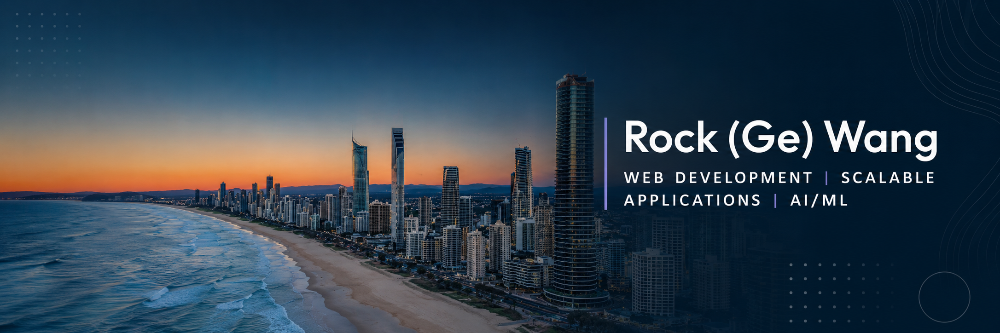

  
  

---

<picture>
  <source media="(prefers-reduced-motion: reduce) and (prefers-color-scheme: dark) and (max-width: 600px)" srcset="assets/profile-terminal-dark-mobile-static.svg" />
  <source media="(prefers-reduced-motion: reduce) and (prefers-color-scheme: light) and (max-width: 600px)" srcset="assets/profile-terminal-light-mobile-static.svg" />
  <source media="(prefers-reduced-motion: reduce) and (prefers-color-scheme: dark)" srcset="assets/profile-terminal-dark-static.svg" />
  <source media="(prefers-reduced-motion: reduce)" srcset="assets/profile-terminal-light-static.svg" />
  <source media="(prefers-color-scheme: dark) and (max-width: 600px)" srcset="assets/profile-terminal-dark-mobile.svg" />
  <source media="(prefers-color-scheme: light) and (max-width: 600px)" srcset="assets/profile-terminal-light-mobile.svg" />
  <source media="(prefers-color-scheme: dark)" srcset="assets/profile-terminal-dark.svg" />
  
</picture>

<h3 id="-featured-projects">
  <picture>
    <source media="(prefers-color-scheme: dark)" srcset="assets/section-projects-dark.svg" />
    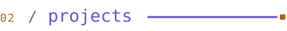
  </picture>
</h3>

<table>
  <tr>
    <td width="50%" valign="top">
      
       <b>Knia Maps.</b> Geospatial ETL for Sydney accessibility mapping, combining Elasticsearch search, PostgreSQL storage and Docker services with reproducible integration tests.
        
      
    </td>
    <td width="50%" valign="top">
      
       <b>CSIRO's Data61.</b> Nine-class scam detection using word and character features, with <b>macro F1 0.948</b> on an <b>18,261-record, template-grouped internal test</b>.
        
      
      
    </td>
  </tr>
  <tr>
    <td width="50%" valign="top">
      
       <b>CSIRO's Data61.</b> A reproducible corpus of <b>194,913</b> scam and legitimate samples from 19 retained source datasets, with verified hashes and traceable provenance.
        
      
    </td>
    <td width="50%" valign="top">
      
       Structured webpage extraction with local LLMs and traceable source evidence. <b>Field exact-match F1 0.938</b> with Qwen on <b>16 synthetic regression fixtures</b>.
        
      
      
    </td>
  </tr>
  <tr>
    <td width="50%" valign="top">
      
       SwiftUI weather app with location-based OpenWeatherMap forecasts, animated transitions and Liquid Glass cards, bringing current conditions and forecast trends into one interface.
        
      
    </td>
    <td width="50%" valign="top">
      
       <b>Experimental</b> YOLOv8s football detection, player tracking and pitch mapping, with a match viewer for one 30-second clip.
        
      
      
      
    </td>
  </tr>
</table>

<b>More projects</b>

 

- [Odyssey](https://github.com/RockENZO/odyssey): a terminal coding agent with 17 tools and local Ollama inference, with a resumable LangGraph engine (see Agent engineering below)
- [MagicTrick](https://github.com/RockENZO/MagicTrick): an iOS card trick with no buttons, only rotate, shake and a secret tap
- [ControllerMouse](https://github.com/RockENZO/ControllerMouse): drive your Mac's cursor with a game controller from the menu bar
- [Road semantic segmentation](https://github.com/RockENZO/Road_Semantic_Segmentation_CV): PyTorch segmentation for driving scenes, with mIoU and FLOPs ablations
- [Flappy Bird DQN](https://github.com/RockENZO/flappy_bird_dqn-main): a DQN agent that learns to play Flappy Bird
- [Feed the World](https://github.com/RockENZO/Feed-the-world-web-app): volunteer-group web app (team project)

<h3 id="-live-playground">
  <picture>
    <source media="(prefers-color-scheme: dark)" srcset="assets/section-playground-dark.svg" />
    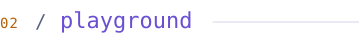
  </picture>
</h3>

<i>Browser demos you can open live. Click a recording to play it.</i>

<table>
  <tr>
    <td width="50%" valign="top" align="center">
      <a href="https://rockenzo.github.io/Roadster-and-Beyond/">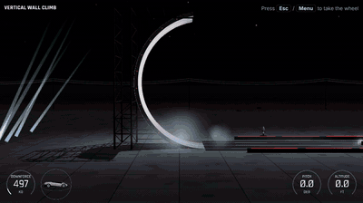</a>
       <b>Roadster and Beyond</b>
       A fan-made recreation of the Tesla Roadster launch night, with rigid-body physics, a broadcast-style HUD, the four highlight stunts and a day or night track day at Spa-Francorchamps. Keyboard and gamepad.
        
      
      
       
      
      
    </td>
    <td width="50%" valign="top" align="center">
      <a href="https://rockenzo.github.io/touch-grass/">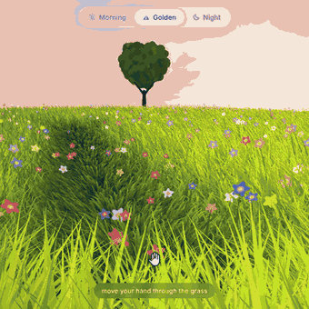</a>
       <b>Touch Grass</b>
       An interactive 3D meadow: run your hand through 260k instanced blades of grass, then switch between Morning, Golden hour and Night.
        
      
      
       
      
      
    </td>
  </tr>
  <tr>
    <td colspan="2" valign="top" align="center">
      <a href="https://rockenzo.github.io/ML-object-detection-project/">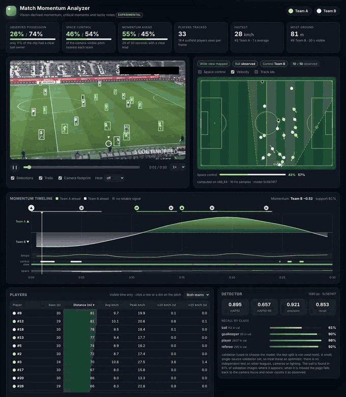</a>
       <b>Football match analysis</b>
       YOLOv8s detection and tracking with automatic pitch mapping, replayed as a static viewer: momentum timeline, critical moments, tactic notes, per-player speed and space control. Experimental, from one 30 s clip.
        
      
      
       
      
      
    </td>
  </tr>
  <tr>
    <td colspan="2" valign="top" align="center">
      <a href="https://rockenzo.github.io/datapipeline-etl/">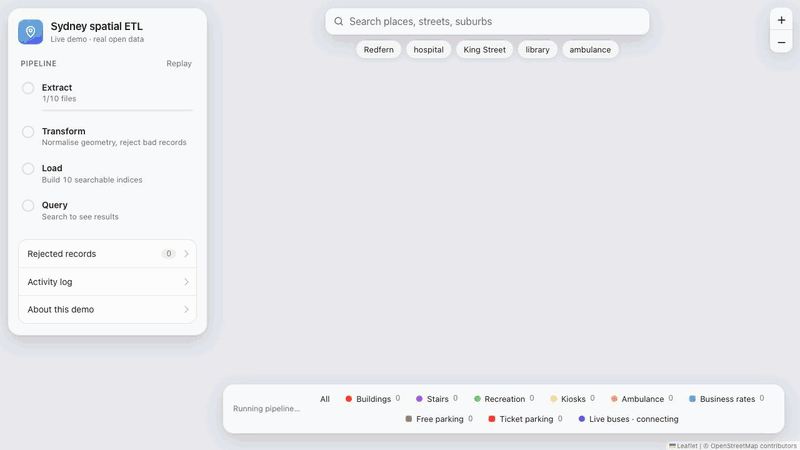</a>
       <b>Sydney spatial ETL</b>
       Explore Sydney’s address data and live NSW bus locations on an interactive map.
        
      
      
       
      
      
    </td>
  </tr>
</table>

<h3 id="-toolshed-collection">
  <picture>
    <source media="(prefers-color-scheme: dark)" srcset="assets/section-toolshed-dark.svg" />
    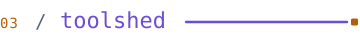
  </picture>
</h3>

  <b>Small tools. Inspectable evidence.</b> 
  My personal collection of focused developer tools.

<table>
  <tr>
    <td width="50%" valign="top" align="center">
      <a href="https://rockenzo.github.io/readme-reality/">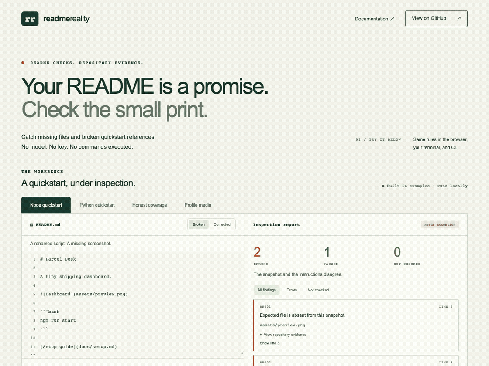</a>
       <b>Readme Reality</b>
       Offline checks for README links, package scripts and Python paths.
        
      
      
    </td>
    <td width="50%" valign="top" align="center">
      <a href="https://rockenzo.github.io/demo-proof/">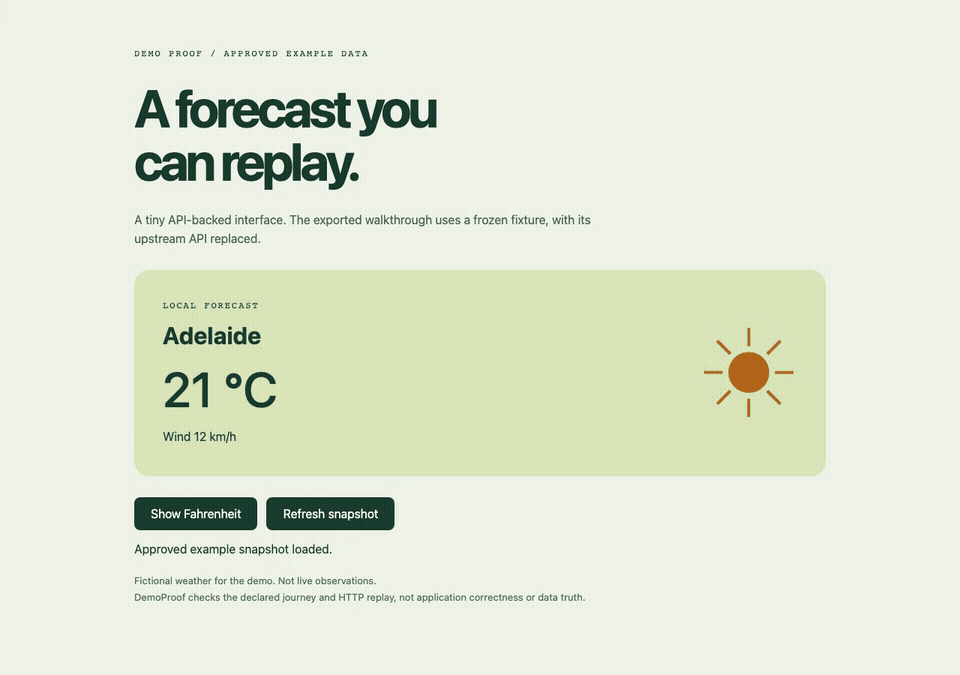</a>
       <b>DemoProof</b>
       An experimental tool for turning approved demo snapshots into replay-verified videos, GIFs and evidence reports.
        
      
      
    </td>
  </tr>
</table>

<h3 id="-agent-engineering">
  <picture>
    <source media="(prefers-color-scheme: dark)" srcset="assets/section-agents-dark.svg" />
    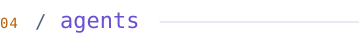
  </picture>
</h3>

  <b>Resumable, verified, measurable.</b> 
  A local coding agent and two small libraries, kept as three independent repos.

<table>
  <tr>
    <td colspan="3" valign="top" align="center">
      
       Kill the process mid-turn, resume from the checkpoint, accept only after the tests pass. The model in this recording is a scripted stand-in.
    </td>
  </tr>
  <tr>
    <td width="33%" valign="top" align="center">
      <b>Odyssey</b>
       Terminal coding agent. LangGraph engine with SQLite checkpoints, approvals and a completion gate. First real run: qwen3.8:27b-mlx passed 10 of 10 tasks of a frozen suite, a pipeline check rather than a capability claim.
        
      
    </td>
    <td width="33%" valign="top" align="center">
      <b>Transactional agent ledger</b>
       SQLite ledger of claims. A step only counts once a verifier, such as the project's test command, accepts it.
        
      
    </td>
    <td width="33%" valign="top" align="center">
      <b>Trajectory replay</b>
       Record a run's tool calls as a cassette, replay it without a model and score trajectories.
        
      
    </td>
  </tr>
</table>

<h3 id="-education--certification">
  <picture>
    <source media="(prefers-color-scheme: dark)" srcset="assets/section-education-dark.svg" />
    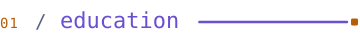
  </picture>
</h3>

- **Master of Information Technology (Applied Artificial Intelligence)**, Adelaide University (2026 to present).
- **Bachelor of Information Technology**, University of Adelaide (2023 to 2025). High Distinctions in Applied Programming and in Computer Systems, Networks &amp; Security; Distinctions in AI Technologies, Web &amp; Database Computing and Programming for IT Specialists.
- **HackerRank Software Engineer** (Sep 2024): problem solving, Python, SQL, REST APIs. 

<h3 id="-development-activity">
  <picture>
    <source media="(prefers-color-scheme: dark)" srcset="assets/section-activity-dark.svg" />
    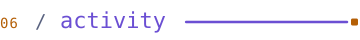
  </picture>
</h3>

  

  
  

  

  

  <picture>
    <source media="(prefers-color-scheme: dark)" srcset="https://raw.githubusercontent.com/RockENZO/RockENZO/output/github-contribution-grid-snake-dark.svg" />
    
  </picture>

<h3 id="-lets-connect">
  <picture>
    <source media="(prefers-color-scheme: dark)" srcset="assets/section-elsewhere-dark.svg" />
    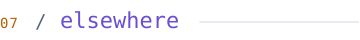
  </picture>
</h3>

  
  
  

  

